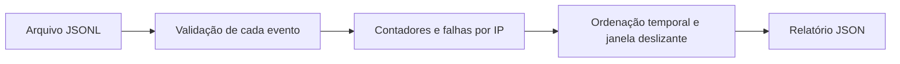

# Arquitetura e decisões

## Fluxo de dados

`parse_event` valida timestamp com fuso, IP e resultado. Campos extras não seguem para o relatório. `analyze` coordena a leitura, contabiliza registros inválidos e correlaciona falhas. `main` trata argumentos, leitura do arquivo e códigos de saída.

A análise mantém eventos de falha em memória para aceitar entradas fora de ordem. A ordenação custa O(n log n) no pior caso; a varredura temporal é linear após ordenar. Para volumes grandes, um pipeline com entrada ordenada e limites de memória seria mais adequado.

## Semântica da regra

Cada IP recebe no máximo uma ocorrência: a primeira janela que atinge o limite. A janela inclui os extremos. Sucessos contam no resumo, mas não apagam falhas. IPs compartilhados podem gerar falsos positivos; uma ocorrência deve ser investigada com contexto.

## Verificação

Os testes exercitam fronteira temporal, ordenação, fusos, IPv6, dados inválidos e execução da CLI. [O relatório de exemplo](../examples/report.json) é produzido a partir de `examples/auth.jsonl`, sem dados reais. A contagem de testes não representa avaliação da eficácia de detecção.
